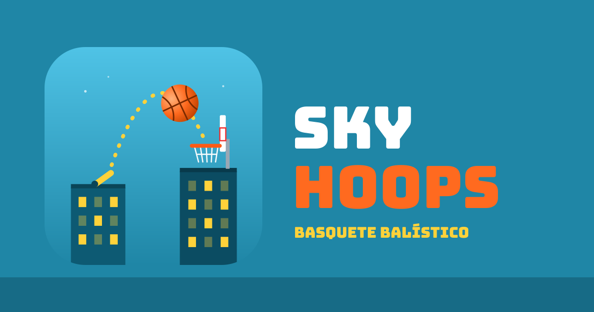

# Sky Hoops — Jogos

A página inicial deixa escolher o jogo:

- **Sky Hoops** (`basquete/`) — basquete galáctico
- **Pedrada** (`pedrada/`) — duelo entre telhados: de 2 a 4 jogadores, cada um num prédio, acertando os outros com pedras; o último em pé vence; mesmo aparelho ou online
- **Órbita** (`orbita/`) — coloque o foguete em órbita: empuxo, ângulo de saída da atmosfera e corte manual do motor; planeta e peso mudam a cada missão
- **Oval Turbo** (`oval-turbo/`) — corrida no oval com curvas inclinadas, estilo Enduro; acelerador + botões ou inclinação do aparelho, travado na horizontal; solo ou online

## Sky Hoops — Basquete Balístico

Do topo de um prédio, acerte a cesta no telhado do outro. Ajuste o **ângulo** e a **força** da catapulta; cada fase muda a distância, a altura dos prédios e a gravidade do planeta (Terra, Lua, Marte, Vênus, Júpiter e Planeta X).

## Modos

- **Online (cada um no seu celular):** uma pessoa toca em *Criar sala* e manda o código de 5 letras (ou o link) para a galera; os outros tocam em *Entrar*. Todos veem a bola voar ao vivo, mas cada um só enxerga os próprios parâmetros (ângulo, força, trajetória anterior e diagnóstico do erro). As mensagens passam por servidores públicos e gratuitos de MQTT (EMQX e HiveMQ, usados ao mesmo tempo), então funciona em qualquer rede, sem conta. O anfitrião precisa manter o jogo aberto.
- **Corrida (mesmo aparelho):** cada um arremessa uma vez por rodada; acertou, avança de fase. Quem passar primeiro da fase final vence. A rodada sempre vai até o fim, e o desempate é por menos arremessos.
- **Solo:** campanha com estrelas (3 estrelas acertando na primeira tentativa).
- **Treino:** gravidade livre, de 0,1 a 3 G.

## Instalar no celular ou tablet

Abra o link do jogo no navegador e:

- **iPhone / iPad (Safari):** botão Compartilhar → *Adicionar à Tela de Início*.
- **Android (Chrome):** menu ⋮ → *Instalar app* (ou *Adicionar à tela inicial*).

Depois de instalado, o jogo abre em tela cheia e funciona sem internet.

## Arquivos

- `index.html` — tela de escolha do jogo
- `basquete/index.html` — Sky Hoops
- `oval-turbo/index.html` — Oval Turbo
- `pedrada/index.html` — Pedrada
- `orbita/index.html` — Órbita
- `manifest.webmanifest` e `sw.js` — instalação como app e funcionamento offline
- `icons/` — ícone e logo
